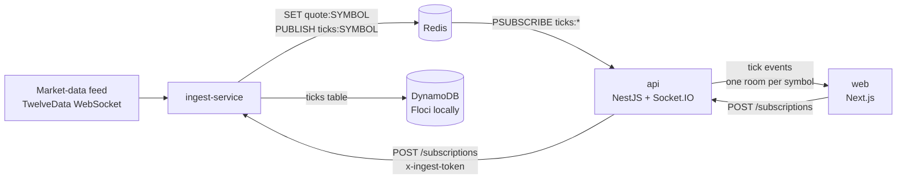

# stock-viewer

A personal learning project: a small real-time price viewer built as a Turborepo monorepo. An ingest service reads ticks from a market-data feed, publishes them through Redis and stores them in DynamoDB. A NestJS API fans them out over Socket.IO to a Next.js page. The feed is a configurable data source (currently TwelveData, picked because it has a free tier); the point of the project is the plumbing around it, not the data.

It is not deployed anywhere. The Terraform in `infra/` has only been applied against Floci, a local AWS emulator, never against real AWS.

## Architecture



- **ingest-service** streams ticks from the feed. For each tick it writes the latest value to the Redis key `quote:{symbol}`, publishes it on the channel `ticks:{symbol}`, and writes it to the DynamoDB ticks table (items expire through a TTL attribute).
- **api** holds a single Redis pattern subscription on `ticks:*` and emits each tick to the Socket.IO room for that symbol. When a client joins a room it first gets the latest value from `quote:{symbol}`, so it does not wait for the next tick.
- **web** connects to the API, lets you type any symbol and shows its live price.

Shared types, Redis key/channel helpers and symbol validation live in `packages/shared`.

## Tech stack

- Monorepo: Turborepo, pnpm workspaces
- web: Next.js 16, React 19, socket.io-client
- api: NestJS 12, Socket.IO, ioredis, Vitest, oxlint
- ingest-service: Node (runs TypeScript directly, no build step), ioredis, AWS SDK for DynamoDB, Vitest
- Data: Redis 7 (latest value and pub/sub), DynamoDB (tick history)
- Infra: Terraform (AWS provider `~> 5.0`), Floci, Docker Compose

## Repo layout

```
apps/
  web/              Next.js live prices page
  api/              NestJS API: Socket.IO gateway and POST /subscriptions
  ingest-service/   Feed -> Redis + DynamoDB, plus a small control server
  docs/             Leftover Turborepo starter app, not used by the project
packages/
  shared/           Types and helpers used by web, api and ingest
  ui/, math/        Small packages used by web (ui and math are mostly starter code)
  eslint-config/, typescript-config/
infra/              Terraform for the DynamoDB tables (Floci)
docker-compose.yaml Floci, Redis, and the ingest service (profile "app")
```

## Running locally

### Prerequisites

- Node >= 24
- pnpm (the repo pins the version in `packageManager` in `package.json`)
- Docker
- Terraform >= 1.7
- An API key for the market-data feed (TwelveData) for the ingest service

### 1. Install and build the shared package

```bash
pnpm install
pnpm --filter @repo/shared build   # api and ingest import it from dist/
```

### 2. Env files

```bash
cp apps/ingest-service/.env.example apps/ingest-service/.env   # set TWELVEDATA_API_KEY and INGEST_TOKEN
cp apps/api/.env.example apps/api/.env                         # INGEST_TOKEN must match ingest's
cp apps/web/.env.example apps/web/.env.local                   # optional, defaults match
```

The `.env` files are git-ignored. Variables are documented in each `.env.example` and in [`apps/ingest-service/README.md`](apps/ingest-service/README.md) and [`apps/web/README.md`](apps/web/README.md).

### 3. Redis and Floci

```bash
docker compose up -d floci redis
```

| Service | Port |
| ------- | ---- |
| Floci   | 4566 |
| Redis   | 6379 |

Floci keeps its state in `./data`.

### 4. Create the DynamoDB tables

Floci must be running first.

```bash
pnpm infra:init                 # terraform init, state kept in ~/.terraform-state/stock-viewer
(cd infra && terraform apply)
```

### 5. Start the services

Run each in its own terminal:

```bash
pnpm --filter ingest-service dev   # control server on :3003
pnpm --filter api dev              # :3002
pnpm --filter web dev              # http://localhost:3000, redirects to /live
```

Alternatively run ingest in Docker through the `app` compose profile (stop any local ingest first, since only one instance should use a feed key):

```bash
docker compose --profile app up --build ingest
```

Compose overrides `REDIS_URL` and `AWS_ENDPOINT_URL` for the container, so the same `.env` works for both. See [`apps/ingest-service/README.md`](apps/ingest-service/README.md) for Docker details and the `/health` endpoint.

## Subscribing to any symbol

The API is not limited to a fixed symbol list. When you pick a symbol in the web page:

1. `web` calls `POST /subscriptions` on the API with `{"symbol": "NVDA"}`.
2. The API validates the symbol and forwards the request to the ingest control server (`POST /subscriptions` on port 3003) with the `x-ingest-token` header.
3. Ingest subscribes to the symbol on the feed and starts publishing `ticks:NVDA`.
4. `web` joins the symbol's Socket.IO room and receives `tick` events.

While a client is subscribed, the API repeats step 2 every 3 minutes. Ingest drops a dynamic symbol after `IDLE_TTL_MS` (default 10 minutes) without a request. The total number of symbols is capped by `MAX_SYMBOLS` (default 8, the free-tier limit). Failures come back as `invalid`, `unsupported`, `capacity` or `unavailable`. Status codes and details are in [`apps/ingest-service/README.md`](apps/ingest-service/README.md). The ingest control port is meant to be reached only by the API.

## Testing, lint and type-check

```bash
pnpm lint
pnpm check-types
pnpm --filter api test
pnpm --filter ingest-service test
pnpm format              # prettier --write on all .ts, .tsx and .md files
```

Build `@repo/shared` first (step 1), otherwise the api and ingest tests cannot resolve it.

Current state: `pnpm check-types` and the api unit tests pass. `pnpm lint` currently fails in `api` (two `curly` errors in `src/redis/redis-subscriber.service.ts`), and one ingest test (`restores persisted dynamic symbols on start`) fails because dynamic symbols are no longer restored on boot. The `web` app has no tests.

## Infrastructure

`infra/` defines two DynamoDB tables (`stock-viewer-local-ticks` and `-quotes`) and points the AWS provider at Floci with dummy credentials. S3 and Secrets Manager resources are present but commented out. Setting `floci_endpoint` to an empty string would target real AWS, but that has not been tried.

## What I am practising

- Agentic coding with Orca: parallel Claude agents on scoped tasks, plan-first review, and PRs
- Terraform as infrastructure as code, tested locally against Floci
- Redis, both as a cache for the latest value and for pub/sub
- WebSockets with Socket.IO: rooms, acks, reconnects
- Building an ingest service and an API backend
